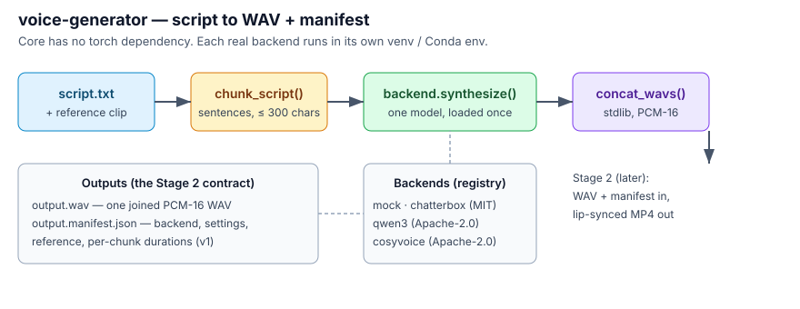

# voice-generator

Local, fully FOSS **voice cloning from a text script** — Stage 1 of the AI
Digital Twin pipeline. Give it a short recording of a voice and a text
script; it renders the script in that voice to a WAV file, entirely on your
own machine. **Zero APIs, zero cloud.**

Stage 2 (the audio-driven talking head that turns this WAV into a
lip-synced video) is a separate, later project. This project's output
contract to Stage 2 is: **one WAV file + one `.manifest.json`** describing
exactly how that WAV was made.

## Description

`voice-gen` is a small command-line tool with one job: script in, cloned
voice out. It splits a long script into sentence-sized chunks, renders
each chunk through one of three interchangeable local TTS engines, joins
the chunks into a single WAV, and writes a provenance manifest beside it.



### Why three engines behind one CLI

The TTS field moves monthly, and the candidate models have wildly
different licenses and install stories. One interface means you can
compare engines on your own voice and script (see
[A/B compare](#ab-compare)) and swap later without touching the CLI,
the chunking, or Stage 2. Backends are isolated in separate environments
because Chatterbox, Qwen3-TTS, and CosyVoice pin conflicting torch/CUDA
stacks — they are never installed into the same environment, and the
core package itself has **no torch dependency**.

| Backend | Status | License | Clone reference | VRAM (community figures) |
|---|---|---|---|---|
| `mock` | Working | — (tone, not speech) | — | 0 — plumbing / timing tests |
| `chatterbox` | Working (v0.1) | MIT — outputs carry a PerTh watermark | ~10 s, no transcript | ~1.5–6 GB |
| `qwen3` | Working (v0.2) | Apache-2.0 | ~3 s **+ exact transcript** | ~4–8 GB |
| `cosyvoice` | Working (v0.3) | Apache-2.0 | ~3 s **+ exact transcript** | ~8–10 GB |

**Which to start with:** Chatterbox — easiest install, no transcript
bookkeeping. Qwen3-TTS next for a smaller/faster Apache-2.0 model.
CosyVoice 3 for multilingual work or Chinese dialects, accepting the
hardest install.

Explicitly **not** included, after license research: Fish Speech
(non-commercial weights), IndexTTS-2 (custom bilibili license —
commercial use only below 100M MAU / RMB 1B revenue; outputs may not
improve other models), F5-TTS / Spark-TTS (non-commercial weights), and
"Breeze TTS 2" (no FOSS release found — only a proprietary hosted API).

### How it works

```
script.txt ──► chunk_script() ──► [chunk 1..N] ──► backend.synthesize() each
                                                          │  (one model loaded
                                                          │   for the whole run)
                                                          ▼
output.wav ◄── concat_wavs() ◄── chunk_001.wav … chunk_N.wav
   │
   └──► output.manifest.json  (backend, settings, reference, per-chunk durations)
```

1. **Chunk** — split on sentence boundaries up to `--max-chars`
   (default 300); a single over-long sentence is hard-split on
   commas/spaces. Smaller chunks = more consistent voice; 250–350 is the
   sweet spot for all three engines.
2. **Validate** — the reference clip is checked (length, channels, rate)
   and warnings printed before synthesis starts.
3. **Synthesize** — the backend loads its model *once*, renders each
   chunk, and writes PCM-16 WAVs via a shared stdlib writer, which is
   what makes joining trivial and exact. Backend-specific prep is done
   once per run too (e.g. Qwen3's voice-clone prompt is built once and
   reused for every chunk).
4. **Join + manifest** — chunks are concatenated sample-accurately
   (formats verified to match first) and the manifest is written
   atomically, so a crash cannot leave a half-written provenance file.

## Prerequisites

| | Minimum | Recommended (target) |
|---|---|---|
| OS | Windows 10/11 64-bit (core + mock also run on Linux/macOS) | Windows 11 |
| GPU | Nvidia, 8 GB VRAM (small models only) | **RTX 3060 12 GB** or better |
| System RAM | 16 GB | 64 GB |
| Disk | ~20 GB free (envs + model weights) | NVMe SSD, 40 GB+ free |
| Nvidia driver | Recent enough for CUDA 12.x PyTorch wheels | Latest Game Ready / Studio |

Software you need before installing:

- **Git** — to clone this project (and the CosyVoice repo, if you use it).
- **Python, per backend** — Chatterbox uses 3.11, Qwen3-TTS upstream
  recommends 3.12, CosyVoice uses Conda with 3.10. The `py` launcher on
  Windows lets all three coexist; that split is by design, not an
  accident.
- **Conda / Miniconda** — only for the CosyVoice backend.
- **sox** — only for CosyVoice (upstream requirement; on Windows install
  the sox binary and put it on PATH).
- **ffmpeg** on PATH — not needed by Stage 1 itself, but Stage 2 will
  require it; `voice-gen doctor` checks for it now so you're ready.

You do **not** need a CUDA toolkit install: the PyTorch wheels each
backend pulls in bring their own CUDA runtime. Device selection is
`auto` by default (CUDA when available, else CPU), so a CPU-only machine
gets a slow render or a clear error, not a cryptic CUDA failure.

## Installation

### Core only (5-minute smoke test, no GPU, no models)

This verifies the whole flow — CLI, chunking, WAV output, manifest —
before you install a single model. The `mock` backend writes a tone WAV
of realistic duration instead of speech.

```bat
cd voice-generator
py -3.11 -m venv .venv-core
.venv-core\Scripts\activate
pip install -e .
voice-gen doctor
voice-gen backends
voice-gen synth --backend mock --text "Hello world. This is a plumbing test." --out output\smoke.wav
```

You should see `output\smoke.wav` and `output\smoke.manifest.json`.
If those appear, the pipeline works and only the model installs remain.

> Linux/macOS: same commands, with `python3 -m venv` and
> `.venv-core/bin/activate`.

### Chatterbox (recommended first)

```bat
py -3.11 -m venv .venv-chatterbox
.venv-chatterbox\Scripts\activate
pip install -e ".[chatterbox]"
voice-gen doctor
```

`doctor` should report torch with CUDA available and your GPU's VRAM.
First synthesis downloads the Chatterbox weights from Hugging Face
(one-time, a few GB) — after that everything is offline.

Chatterbox variants (`--variant`): `turbo` (default — English, fast,
paralinguistic tags like `[laugh]`, `[sigh]`), `original` (English,
strongest CFG / exaggeration control), `multilingual` (23+ languages;
pass `--language es`, `fr`, etc.).

### Qwen3-TTS

```bat
py -3.12 -m venv .venv-qwen3
.venv-qwen3\Scripts\activate
pip install -e ".[qwen3]"
voice-gen doctor
```

Qwen3 cloning facts (verified against the upstream README, 2026-10-22):

- Cloning lives in the **Base** checkpoints: `--model-size 1.7b`
  (default) or `0.6b`. First run downloads the weights from Hugging Face.
- **Full cloning needs the reference clip's exact transcript** —
  `--ref-text "..."` or `--ref-text-file refs\me.txt`. Word-for-word,
  including fillers; if the transcript doesn't match the audio, clone
  quality drops. Without a transcript, `--x-vector-only` clones from the
  speaker embedding only (works, noticeably worse).
- The clone prompt is built **once per run** and reused for every chunk.
- Attention defaults to `sdpa` (Windows-friendly). Upstream recommends
  FlashAttention 2; opt in with `--attn flash_attention_2` *only* if you
  have it installed.
- Languages are given to the model as full names; the CLI maps its ISO
  codes for you (`en` → `English`, `es` → `Spanish`, …). Supported:
  en, zh, ja, ko, de, fr, ru, pt, es, it.

### CosyVoice 3 (advanced)

CosyVoice is **not a pip package**. Upstream's path (verified 2026-10-22):

```bat
git clone --recursive https://github.com/FunAudioLLM/CosyVoice.git
conda create -n cosyvoice -y python=3.10
conda activate cosyvoice
cd CosyVoice
pip install -r requirements.txt
python -c "from huggingface_hub import snapshot_download; snapshot_download('FunAudioLLM/Fun-CosyVoice3-0.5B-2512', local_dir='pretrained_models/Fun-CosyVoice3-0.5B')"
pip install -e <path-to-voice-generator>
```

Notes:

- The `--recursive` clone matters: the backend loads the repo's
  `third_party/Matcha-TTS` submodule onto `sys.path`, exactly like
  upstream's `example.py`. If imports fail with `No module named matcha`,
  run `git submodule update --init --recursive` inside the clone.
- Point the CLI at the clone with `--cosyvoice-home C:\path\to\CosyVoice`
  (or set `COSYVOICE_HOME`), and at a non-default model location with
  `--cosy-model-dir` / `COSYVOICE_MODEL_DIR`.
- Zero-shot mode needs the reference transcript (same rule as Qwen3).
  CosyVoice has no transcript-free clone mode; `--cosy-mode cross_lingual`
  is the alternative — it clones across languages without a transcript.
- For CosyVoice 3 the backend automatically formats the zero-shot prompt
  the way upstream's official example does:
  `You are a helpful assistant.<|endofprompt|>` + your transcript.
  With `--cosy-version 2` the bare transcript is used. Don't add the
  prefix yourself — if your transcript file already contains
  `<|endofprompt|>`, the backend leaves it untouched.
- On Windows this is the fiddliest install of the three. If it fights
  you, that's expected — Chatterbox and Qwen3 already cover most use
  cases, and WSL2 is a legitimate escape hatch for this backend only.

### Recording a good reference clip

Clone quality is mostly decided here, before any model runs.

- **Length:** ~10 s for Chatterbox; ~3–10 s for Qwen3 / CosyVoice.
  Longer is *not* better — 10–30 s of clean speech beats a noisy minute.
- **Content:** natural, expressive, normal speaking pace. Avoid
  whispering, shouting, or a "radio voice".
- **Environment:** quiet room, no music, no TV, no echoey acoustics,
  microphone 15–30 cm away, no clipping.
- **One speaker only.** Any second voice in the clip becomes part of the
  "voice".
- **Format:** WAV, mono preferred, 16 kHz or higher. Convert first:
  `ffmpeg -i ref.mp3 -ac 1 -ar 24000 ref.wav`.
- **Transcript (Qwen3 / CosyVoice):** type *exactly* what is said,
  fillers and all, and save it next to the clip (`refs\me.txt` beside
  `refs\me.wav` is this project's convention).
- **Check it:** `voice-gen check-ref refs\me.wav` flags clips that are
  too short, stereo, or low sample-rate before you burn a render on them.

## Usage

Every command is `voice-gen <subcommand>`, run inside the venv of the
backend you're using. Expected failures (missing file, bad input,
backend not installed) print a one-line `Error:` and exit 1 instead of
a traceback.

```bat
:: 1. Sanity-check the environment
voice-gen doctor
voice-gen backends

:: 2. Validate your reference clip
voice-gen check-ref refs\me_10s.wav

:: 3. Chatterbox — one line, then a full script (chunked automatically)
voice-gen synth --text "Hello, this is my digital twin." --ref refs\me_10s.wav --out output\hello.wav
voice-gen synth --script script.txt --ref refs\me_10s.wav --out output\ep1.wav

:: 4. Chatterbox — expressive / multilingual
voice-gen synth --text "I can't believe it [laugh] we actually did it." --ref refs\me_10s.wav --out output\laugh.wav --variant turbo --exaggeration 0.7
voice-gen synth --text "Hola, esta es mi gemela digital." --ref refs\me_10s.wav --out output\hola.wav --variant multilingual --language es

:: 5. Qwen3-TTS (activate .venv-qwen3 first)
voice-gen synth --backend qwen3 --script script.txt --ref refs\me_3s.wav --ref-text-file refs\me.txt --out output\ep1_qwen.wav
voice-gen synth --backend qwen3 --text "Smaller and faster." --ref refs\me_3s.wav --ref-text-file refs\me.txt --model-size 0.6b --out output\small.wav
voice-gen synth --backend qwen3 --text "No transcript handy." --ref refs\me_3s.wav --x-vector-only --out output\xvec.wav

:: 6. CosyVoice 3 (activate the cosyvoice Conda env first)
voice-gen synth --backend cosyvoice --script script.txt --ref refs\me.wav --ref-text-file refs\me.txt --cosyvoice-home C:\path\to\CosyVoice --out output\ep1_cosy.wav
voice-gen synth --backend cosyvoice --text "Cross lingual, no transcript." --ref refs\me.wav --cosy-mode cross_lingual --cosyvoice-home C:\path\to\CosyVoice --out output\cross.wav
```

Output per render: the WAV, a `.manifest.json` beside it, and a
`.<name>.parts` folder next to the output holding the per-chunk WAVs
(kept so you can re-join or inspect a bad chunk without re-rendering).

### The manifest (output contract)

Every render writes `<output-name>.manifest.json`. Real example (mock run):

```json
{
  "manifest_version": 1,
  "backend": "mock",
  "license": "MIT (project code; generates a tone, not speech)",
  "backend_settings": {"note": "tone only — not speech", "language": "en"},
  "reference_wav": "refs/me.wav",
  "reference_text": null,
  "x_vector_only": false,
  "language": "en",
  "output": "ep1.wav",
  "duration_s": 5.643,
  "sample_rate": 24000,
  "chunks": [
    {"index": 1, "text": "Hello world…", "wav": "chunk_001.wav", "duration_s": 5.643}
  ]
}
```

This file is the Stage 2 contract: a talking-head render will read the
WAV path, duration, and provenance from here instead of guessing. If a
render ever sounds wrong, the manifest tells you which engine,
reference, and settings produced it — reproduce first, tweak second.
Stage 2 must accept a manifest without `manifest_version` as version 0
(pre-review manifests, which also lack `backend_settings`).

### A/B compare

The backends live in separate environments, so no single interpreter can
import two of them. `tools\ab_compare.py` (stdlib-only — run it with any
Python) drives each environment's interpreter as a subprocess with the
*same* script and reference, then compares the manifests. Any subset of
the three sides may be given.

```bat
python tools\ab_compare.py --script script.txt --ref refs\me.wav --ref-text-file refs\me.txt --chatterbox-python .venv-chatterbox\Scripts\python.exe --qwen-python .venv-qwen3\Scripts\python.exe --cosy-python C:\Users\you\miniconda3\envs\cosyvoice\python.exe --cosyvoice-home C:\path\to\CosyVoice --out-dir output\ab1
```

Produces `chatterbox.wav`, `qwen3.wav`, `cosyvoice.wav`, and
`ab_comparison.json` (per-backend duration, sample rate, wall-clock
time). A backend that isn't installed doesn't crash the run — its
failure and the install hint are recorded in the JSON. The comparison
itself is your ears; the JSON is diagnostics, not a quality score.

### CLI reference

`voice-gen doctor` — Python version, torch/CUDA/GPU/VRAM if present,
which backends are importable in this env, ffmpeg on PATH.
`voice-gen backends` — list the backends in this build.
`voice-gen check-ref <ref.wav>` — duration/rate/channels + warnings.

`voice-gen synth` options:

| Option | Default | Applies to | Meaning |
|---|---|---|---|
| `--text` / `--script` | (one required) | all | inline text, or a `.txt` script file |
| `--ref` | — | all real | reference voice clip (.wav) |
| `--out` | (required) | all | output `.wav` path |
| `--backend` | `chatterbox` | all | `mock` / `chatterbox` / `qwen3` / `cosyvoice` |
| `--language` | `en` | all | ISO code; Qwen maps to full names |
| `--max-chars` | `300` | all | chunk size ceiling |
| `--variant` | `turbo` | chatterbox | `original` / `turbo` / `multilingual` |
| `--exaggeration` | `0.5` | chatterbox | emotion intensity 0–1+ |
| `--cfg` | `0.5` | chatterbox | CFG weight (adherence vs freedom) |
| `--ref-text` / `--ref-text-file` | — | qwen3, cosyvoice | exact transcript of `--ref` |
| `--x-vector-only` | off | qwen3 | clone from speaker embedding only |
| `--model-size` | `1.7b` | qwen3 | `1.7b` / `0.6b` Base checkpoint |
| `--attn` | `sdpa` | qwen3 | `sdpa` / `eager` / `flash_attention_2` |
| `--cosyvoice-home` | `$COSYVOICE_HOME` | cosyvoice | path to the CosyVoice clone |
| `--cosy-model-dir` | clone default | cosyvoice | model snapshot directory |
| `--cosy-mode` | `zero_shot` | cosyvoice | `zero_shot` / `cross_lingual` |
| `--cosy-version` | `3` | cosyvoice | prompt format / default model dir |

### Troubleshooting

| Symptom | Likely cause → fix |
|---|---|
| `torch … CUDA not available` in `doctor` | CPU-only torch wheel, or driver too old → reinstall the backend extra in a *fresh* venv; update the Nvidia driver. |
| Backend "not installed in this environment" | You're in the wrong venv → activate that backend's env (each backend has its own; this is by design). |
| First synthesis hangs for minutes | It's downloading model weights from Hugging Face (one-time, several GB). Later runs are offline. |
| `OutOfMemoryError` / CUDA OOM on 12 GB | Something else holds VRAM → close it; for Qwen3 try `--model-size 0.6b`; render stages sequentially, never in parallel. |
| Clone sounds like a different person | Noisy/multi-speaker/short reference, or transcript doesn't match audio word-for-word (Qwen3/CosyVoice) → re-record clean, fix the transcript. |
| Clone sounds right but "flat" | Reference delivery was flat, or Chatterbox `--exaggeration` too low → raise to 0.6–0.8; re-record with more expression. |
| Robotic gaps between sentences | Chunk boundaries → raise `--max-chars` a bit, or accept it (Stage 2 hides a lot). |
| Qwen3: transcript error on synth | Full cloning needs `--ref-text`/`--ref-text-file`, or pass `--x-vector-only`. |
| Qwen3: `flash_attention_2` import error | You opted in without it installed → drop `--attn` (default `sdpa`). |
| CosyVoice: `No module named cosyvoice` | Not in the Conda env, or `--cosyvoice-home` wrong → the backend's error message prints the full setup recipe. |
| CosyVoice: `No module named matcha` | Submodules missing → `git submodule update --init --recursive` in the clone. |
| CosyVoice: sox errors / silent failures | sox not installed or not on PATH → install sox, restart the terminal, verify with `sox --version`. |
| Garbled / wrong-language output | `--language` mismatch, or Chatterbox `turbo`/`original` (English-only) used for non-English → use `multilingual` or the right `--language`. |
| WAV plays but is silent / a tone | You rendered with `--backend mock`. It writes a tone *on purpose* — switch to a real backend. |

### Performance and VRAM notes

- All figures are per-stage, with nothing else on the GPU. VRAM numbers
  in the backend table are community-reported ranges, not vendor specs —
  treat the first render on your machine as the real measurement
  (`voice-gen doctor` shows total VRAM; watch usage in Task Manager /
  `nvidia-smi` during a render).
- Chunk count is the main speed lever: a 10-minute script at 300 chars
  is roughly 40–60 chunks. Model load time is paid once per run, so
  batch scripts into one run instead of many small ones.
- Qwen3 `0.6b` is the fast/small option; `1.7b` is the quality option.
  Chatterbox `turbo` is faster than `original`.

## Local Development

```bat
pip install -e ".[dev]"
pytest        :: 27 tests, no GPU, no downloads, no torch needed
ruff check src tests tools
```

How the tests work: the core is tested for real (chunking, WAV handling,
full mock pipeline, CLI end-to-end). The GPU backends are tested against
*fake* upstream modules injected into `sys.modules` — the fakes record
their arguments, so tests pin the exact API contract (e.g. Qwen3's
prompt is built once and reused; CosyVoice 3's prompt gets the
`<|endofprompt|>` format, v2's doesn't). If upstream changes its API,
these tests are where it shows. `tests/test_review.py` pins the fixes
from the 2026-10-31 staff review (see `REVIEW.md`).

**Adding a new backend** (the extension point, ~1 hour):

1. Create `src/voice_generator/backends/<name>_backend.py` implementing
   `BaseBackend.synthesize(request, out_wav) -> SynthesisResult`.
   Import heavy deps *inside* methods, never at module top.
2. Register it in `backends/__init__.py` (one line in `BACKENDS`, plus
   its engine import name in `BACKEND_IMPORTS` for `doctor`).
3. Always write output as PCM-16 WAV via `audio.write_pcm16_wav` —
   that's what chunk concatenation depends on.
4. Add its constructor knobs to `SynthConfig.backend_kwargs()` and the CLI.
5. Add fake-module tests in the style of `test_qwen.py` / `test_cosy.py`.

**Project layout:**

```
voice-generator/
├── pyproject.toml            # package metadata; per-backend extras
├── README.md                 # this file
├── REVIEW.md                 # staff review (2026-10-31) + fix log
├── CHANGELOG.md
├── LICENSE                   # MIT
├── src/voice_generator/
│   ├── cli.py                # voice-gen: doctor / backends / check-ref / synth
│   ├── pipeline.py           # SynthConfig + script → chunks → WAV + manifest
│   ├── text.py               # sentence chunking
│   ├── audio.py              # WAV info, reference checks, PCM-16 write, concat
│   ├── __main__.py           # python -m voice_generator (used by the A/B tool)
│   └── backends/
│       ├── base.py           # SynthesisRequest/Result, require_reference, resolve_device
│       ├── __init__.py       # lazy registry (no heavy imports at startup)
│       ├── mock_backend.py   # tone WAV, realistic duration, zero deps
│       ├── chatterbox_backend.py
│       ├── qwen_backend.py
│       └── cosy_backend.py
├── tools/
│   └── ab_compare.py         # cross-environment A/B rendering
├── docs/assets/
│   └── architecture.svg      # pipeline diagram (see Visual assets)
└── tests/                    # pytest; fake engine modules, no GPU/downloads
```

**Known limitations / honest status**

- **v0.3.1.** Verified on a GPU-less Linux box: 27/27 tests, ruff
  clean, wheel builds as 0.3.1 from the single version source.
- **Not yet verified:** a real render on the RTX 3060. The backend APIs
  were verified against the upstream READMEs/examples on 2026-10-22,
  but the first GPU run is yours — if a backend breaks there, the error
  messages and the troubleshooting table above are the first stop, and
  the chunk/manifest plumbing around it is already proven.
- Japanese in CosyVoice cross-lingual mode needs katakana-converted text
  (upstream note).
- Chatterbox outputs carry Resemble's imperceptible PerTh watermark —
  disclosed by upstream, not removable, and not a license restriction.

## Deployment

This is a local CLI, not a service — "deployment" means getting it
running on the target machine and keeping it reproducible there. There
is no server, no Docker image, and no hosted component to deploy.

**Deploy to the target Windows box (the intended path):**

1. Copy the project folder (or clone the repo) to the box.
2. Create one venv per backend you will actually use (see
   [Installation](#installation)) — do not merge them into one env.
3. Run `voice-gen doctor` in each venv and confirm CUDA + VRAM.
4. Run the mock smoke test, then one real render per backend, then the
   A/B compare on your own voice and script. That sequence is the
   deployment gate: if all three pass, the box is deployed.
5. Model weights live in the Hugging Face cache on that box after first
   run; the box is then fully offline. Back up `refs/` (your reference
   clips + transcripts) separately — they are the irreplaceable inputs.

**Packaging a release:**

```bat
pip install build
python -m build          :: sdist + wheel under dist/
```

The wheel is the distributable artifact; the version comes from
`voice_generator.__version__` alone, so a release is a one-line bump
plus a `CHANGELOG.md` entry. CI (`.github/workflows/ci.yml`) runs the
GPU-free suite on Ubuntu + Windows, Python 3.10–3.12, on every push/PR —
it deliberately does *not* gate on real-backend renders, which can only
run on the target GPU box.

**What deployment is not:** there is no auto-update, no telemetry, and
no remote model serving in this project. If a future Stage 2 service
needs this as a library, import `voice_generator.pipeline` (not the
CLI) and note the CosyVoice backend's `sys.path` mutation — see
`REVIEW.md` §3 for the embedding caveat.

**Licenses:** this project is MIT. Chatterbox: MIT (code + weights).
Qwen3-TTS: Apache-2.0. CosyVoice 2/3: Apache-2.0. Cloning a voice you
don't have the rights to is your legal problem, not the models'. Use
your own voice or get permission.

## Visual assets

Repo presence, in priority order. Rule for all of them: **capture from
real runs, never mock up.** A faked screenshot in a voice-cloning repo
destroys exactly the trust the tool needs.

1. **Architecture diagram — DONE, shipped.**
   `docs/assets/architecture.svg`, embedded at the top of
   [Description](#description). It shows script → chunking → backend
   (registry, one env each) → concatenation → WAV + manifest → Stage 2.
   It is an SVG (not a screenshot) because the pipeline, unlike a render,
   is stable — it won't go stale when a backend version changes.
2. **Terminal quickstart GIF — to capture, highest value after the diagram.**
   File: `docs/assets/terminal-quickstart.gif`. Content: the real core
   smoke test — `voice-gen doctor`, `voice-gen synth --backend mock`,
   the `Done:` line, then `dir output` showing `smoke.wav` +
   `smoke.manifest.json`. Capture on Windows Terminal (or `script`
   + a GIF converter on Linux). Placement: immediately after the
   "Core only" smoke-test block in
   [Installation](#installation), captioned with the exact commands
   shown. Why it matters: it proves the 5-minute claim in under 20
   seconds of viewing.
3. **A/B waveform figure — to capture after the first GPU renders.**
   File: `docs/assets/ab-waveforms.png`. Content: one figure with three
   aligned waveform strips (Chatterbox / Qwen3 / CosyVoice) for the
   *same* sentence, plus the `ab_comparison.json` duration/wall-time
   table beneath. Generate the strips from the real A/B output WAVs
   (e.g. with matplotlib or Audacity screenshots — not hand-drawn).
   Placement: at the end of the [A/B compare](#ab-compare) section.
   Why: it is the only visual that answers "do these actually sound
   different?" and it reuses artifacts the user already produces.
4. **Reference-clip guide figure — to capture, lowest priority.**
   File: `docs/assets/reference-clip.png`. Content: two waveform strips
   side by side — a good clip (clean, single speaker, ~10 s, no
   clipping) vs a bad one (clipped peaks / background noise / long
   silence). Placement: at the end of the "Recording a good reference
   clip" subsection. Why: reference quality is the #1 clone-quality
   lever, and a picture teaches it faster than the bullet list.

Do **not** ship: a hero banner with a fake avatar, stock "AI voice"
imagery, or any screenshot showing a render that was not produced by
this tool. If an asset cannot be captured from a real run yet, leave
its slot empty and say so — a missing image is honest, a fake one is
not.

## Roadmap

1. **v0.1** — core + Chatterbox + mock, CLI, manifest, tests.
2. **v0.2** — Qwen3-TTS backend in its own venv, `--ref-text` support,
   A/B compare tool.
3. **v0.3** — CosyVoice 3 backend (local repo clone in its Conda env),
   A/B tool extended to all three backends.
4. **v0.3.1 (this)** — staff review: manifest provenance fix, CLI error
   handling, `SynthConfig`, device auto-detect, LICENSE/CHANGELOG/CI,
   rewritten README.
5. v0.4 — the handoff contract with Stage 2 (EchoMimicV3 Flash /
   MuseTalk): WAV + manifest in, lip-synced MP4 out.
